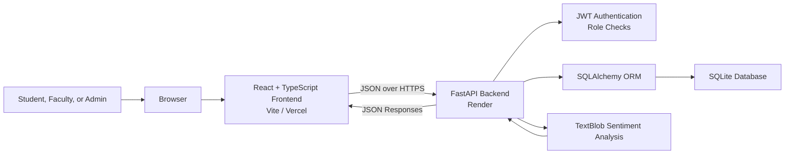

# InsightEd

[](https://insight-ed-rust.vercel.app/)
[](https://react.dev/)
[](https://fastapi.tiangolo.com/)
[](#license)

InsightEd is a role-aware academic feedback application. It gives students a place to submit course feedback and gives faculty and administrators a way to review ratings, sentiment, and written comments. The project combines a React frontend with a FastAPI API and a SQLite database.

## Live Demo

- **Application:** [https://insight-ed-rust.vercel.app/](https://insight-ed-rust.vercel.app/)
- **Source code:** [https://github.com/HemaS11/InsightEd](https://github.com/HemaS11/InsightEd)

The frontend requires a reachable backend API. For a deployed setup, configure the frontend API URL and the backend's allowed frontend origin as described in [Deployment](#deployment).

## Key Features

### Authentication and roles

- Sign in with email and password.
- Self-registration is available for student and faculty accounts.
- Passwords are hashed with bcrypt; successful login returns a signed JWT access token that expires after 60 minutes.
- Backend routes enforce role permissions. The frontend also filters navigation options by role.
- Administrator accounts are created through the backend's interactive `create_admin.py` script; public registration does not allow the admin role.

### Student feedback

- Submit feedback for a course and instructor with written comments and star ratings.
- The form calculates one average rating from its four rating inputs; that single rating, the course, instructor, comment, submitting user ID, and generated sentiment fields are stored.
- View the signed-in student's feedback history. The backend filters student feedback to records owned by that account.
- TextBlob polarity is used to classify comments as positive, neutral, or negative.

> **Privacy note:** Feedback records are associated with the submitting user's ID in the database, even though the form describes feedback as intended to be anonymous. Do not treat submissions as anonymous without changing the implementation and clearly informing users.

### Faculty and administrator analytics

- Dashboard summary statistics for total feedback, average rating, sentiment, and courses below the dashboard's 3.5 rating threshold.
- Course-level feedback counts and average ratings.
- Overall and course-level sentiment summaries.
- Topic insights based on predefined keywords for teaching quality, course content, practical learning, course pace, and learning resources.
- Rule-based course suggestions derived from average ratings, negative sentiment counts, and the number of comments.
- Feedback summary and CSV download.

Topic matching and recommendations are deterministic rules in the frontend; they are not generated by an AI model.

### Administrator user management

- List registered users.
- Create student and faculty accounts.
- Public registration does not create administrator accounts.

## Technology Stack

| Area | Technologies used |
|---|---|
| Frontend | React 19, TypeScript, Vite |
| UI and charts | CSS, Framer Motion, Recharts, Lucide React |
| Backend | Python, FastAPI, Pydantic, SQLAlchemy, Uvicorn |
| Database | SQLite |
| Authentication | JWT (`PyJWT`, HS256), HTTP bearer authentication, bcrypt password hashing |
| Sentiment | TextBlob polarity analysis |

Dependency versions and frontend commands are defined in [`package.json`](./package.json) and [`package-lock.json`](./package-lock.json). Backend dependencies are listed in [`Backend/requirements.txt`](./Backend/requirements.txt).

## Project Architecture

The browser application makes JSON requests to the FastAPI backend. The backend validates requests, applies authentication and role checks, reads and writes SQLite records through SQLAlchemy, and computes sentiment when feedback is submitted.



In local development, the frontend defaults to `http://127.0.0.1:8000` for the API. Localhost/127.0.0.1 frontend ports are allowed by the backend CORS middleware. For hosted use, set an explicit API base URL and configure the backend to allow the exact frontend origin.

## Project Folder Structure

```text
InsightEd/
├── Backend/
│   ├── auth.py                    # JWT creation, authentication, and role checks
│   ├── create_admin.py            # Interactive administrator account setup
│   ├── database.py                # SQLite engine, session, and table creation
│   ├── main.py                    # FastAPI app, CORS, and API routes
│   ├── migrate_feedback_ownership.py # One-time feedback ownership migration
│   ├── models.py                  # SQLAlchemy User and Feedback models
│   ├── requirements.txt           # Python dependencies
│   ├── reset_admin.py             # Interactive administrator password reset
│   ├── schemas.py                 # Pydantic request/response models
│   └── sentiment.py               # TextBlob sentiment classification
├── public/                        # Static frontend assets
├── src/
│   ├── components/                # Navigation and reusable UI components
│   ├── pages/                     # Login, dashboard, feedback, analytics, reports
│   ├── services/api.ts            # Frontend API requests and response types
│   ├── App.tsx                    # Role-aware app navigation and page rendering
│   └── main.tsx                   # React entry point
├── .env.example                   # Safe environment-variable examples
├── package.json                   # Frontend dependencies and scripts
├── vite.config.ts                 # Vite development and preview configuration
└── README.md
```

The SQLite database file is created at runtime in the backend's current working directory. It is not a source file; back it up and use persistent storage for deployed data.

## Installation & Local Setup

### Prerequisites

- Git
- Node.js compatible with Vite 8 (Node.js 20.19+ or 22.12+)
- Python 3.9 or newer
- npm (included with Node.js)

### 1. Clone the repository

```bash
git clone https://github.com/HemaS11/InsightEd.git
cd InsightEd
```

### 2. Install frontend dependencies

```bash
npm install
```

Copy the example file for Vite's local environment:

```bash
cp .env.example .env
```

The frontend reads `VITE_API_BASE_URL` when Vite starts/builds. The default points to the local backend.

### 3. Set up and install the backend

```bash
cd Backend
python3 -m venv venv
source venv/bin/activate
python -m pip install -r requirements.txt
```

On Windows PowerShell, activate the environment with:

```powershell
.\venv\Scripts\Activate.ps1
```

### 4. Configure backend environment variables

The backend reads environment variables from its process; it does not load the root `.env` file automatically. For local development, set them in the backend terminal:

```bash
export APP_ENV=development
export JWT_SECRET_KEY="replace-with-a-random-secret-at-least-32-characters-long"
```

Generate a suitable local secret with:

```bash
python -c "import secrets; print(secrets.token_urlsafe(48))"
```

Copy the generated value into `JWT_SECRET_KEY`. Local CORS access for `localhost` and `127.0.0.1` is enabled on any port; `CORS_ORIGINS` is only needed for additional, explicitly trusted origins such as the deployed frontend.

### 5. Create an administrator account

The public registration form supports student and faculty accounts only. To create the first administrator, run this from the `Backend` directory and follow the prompts:

```bash
python create_admin.py
```

The script asks for the administrator's name, email, and password and does not print or store a plaintext password.

## Running the Application

### 1. Start the Backend

From the `Backend` directory, start the FastAPI service on port `8000`:

```bash
uvicorn main:app --reload --host 127.0.0.1 --port 8000
```

### 2. Start the Frontend

Open a separate terminal, navigate to the repository root, and run:

```bash
npm install
npm run dev
```

Open the local URL printed by Vite (usually `http://localhost:5173`). If that port is occupied, Vite may select another available port. Localhost and `127.0.0.1` frontend origins are allowed by the backend CORS configuration.

### 3. Backend Endpoints

| Purpose | URL |
|---|---|
| Backend health check | [http://127.0.0.1:8000/health](http://127.0.0.1:8000/health) |
| Interactive API documentation | [http://127.0.0.1:8000/docs](http://127.0.0.1:8000/docs) |
| Local frontend | [http://localhost:5173](http://localhost:5173) |

The FastAPI interactive documentation allows developers to explore and test the available API endpoints.

### Frontend Checks

```bash
npm run build
npm run lint
```

## Environment Variables

| Variable | Used by | Required | Description |
|---|---|---:|---|
| `VITE_API_BASE_URL` | Frontend | No for local development; **yes for a separately hosted backend** | Base URL of the FastAPI service, without a trailing slash. Defaults to `http://127.0.0.1:8000`. |
| `JWT_SECRET_KEY` | Backend | Yes in production | Secret used to sign and verify JWTs. Must be at least 32 characters. Generate a unique value; do not commit it. |
| `APP_ENV` | Backend | No | Set to `production` to require `JWT_SECRET_KEY`. When unset or non-production, the code uses a built-in development fallback if the key is absent; never rely on that fallback in production. |
| `CORS_ORIGINS` | Backend | No locally; set for hosted frontend origins | Comma-separated exact frontend origins allowed by CORS, for example `https://insight-ed-rust.vercel.app`. |

Safe example values (replace the secret before use):

```dotenv
# Frontend
VITE_API_BASE_URL=http://127.0.0.1:8000

# Backend (set in the backend process or deployment environment)
APP_ENV=development
JWT_SECRET_KEY=replace-with-a-random-secret-at-least-32-characters-long
CORS_ORIGINS=https://insight-ed-rust.vercel.app
```

Only variables prefixed with `VITE_` are intended for the browser build. Never place secrets in `VITE_*` variables: frontend environment values are embedded into client-side assets.

## API Documentation

All endpoints are defined in [`Backend/main.py`](./Backend/main.py). Protected endpoints require an `Authorization: Bearer <access_token>` header. Login returns a token valid for 60 minutes.

| Method | Path | Access | Purpose |
|---|---|---|---|
| `GET` | `/` | Public | Basic API welcome/status response. |
| `GET` | `/health` | Public | Health check. |
| `POST` | `/auth/register` | Public | Register a student or faculty account. Admin registration is not allowed. |
| `POST` | `/auth/login` | Public | Verify credentials and return an access token and user profile. |
| `POST` | `/feedback` | Student | Submit course feedback. Sentiment is calculated by the backend. |
| `GET` | `/feedback` | Authenticated | List feedback; students receive their own records, faculty/admin receive all records. |
| `GET` | `/feedback/{feedback_id}` | Authenticated | Get a feedback record; students can only access their own. |
| `GET` | `/analytics` | Faculty, admin | Aggregate total, average rating, and sentiment counts. |
| `GET` | `/analytics/courses` | Faculty, admin | Feedback counts and average ratings grouped by course and instructor. |
| `GET` | `/analytics/sentiment` | Faculty, admin | Sentiment counts grouped by course and instructor. |
| `GET` | `/admin/users` | Admin | List user accounts. |
| `POST` | `/admin/users` | Admin | Create a student or faculty account. |

### Example login request

```bash
curl -X POST http://127.0.0.1:8000/auth/login \
  -H "Content-Type: application/json" \
  -d '{"email":"student@example.com","password":"your-password"}'
```

Use the returned `access_token` as a bearer token for protected requests:

```bash
curl http://127.0.0.1:8000/feedback \
  -H "Authorization: Bearer <access_token>"
```

The interactive OpenAPI page exposes the same routes and schemas at `/docs` when the backend is running.

## User Roles & Workflows

| Role | Workflow and permissions |
|---|---|
| **Student** | Self-register or sign in, submit course feedback, and view their own feedback history. The backend denies student access to analytics and admin user management. |
| **Faculty** | Self-register or sign in, view all feedback, and access dashboard, course, and sentiment analytics, topic insights, recommendations, and reports. Faculty cannot create or list user accounts. |
| **Admin** | Sign in to view feedback and analytics, and create/list student and faculty accounts. The first admin must be created with `Backend/create_admin.py`; admin creation is not exposed through public registration. |

**Implementation note:** The frontend currently has one shared dashboard screen, not separate admin, faculty, and student dashboard implementations. It requests analytics endpoints restricted to faculty/admin; the backend returns `403` to a student for those requests. A working student-specific analytics dashboard is not implemented.

## Deployment

The frontend is deployed on Vercel at the [live demo](https://insight-ed-rust.vercel.app/); deploy the FastAPI backend as a separate Render web service. The repository does not include Vercel or Render service manifests, so configure these settings in each provider's project dashboard.

### Frontend — Vercel

1. Import the GitHub repository into Vercel.
2. Set the project root to the repository root.
3. Use `npm run build` as the build command and `dist` as the output directory.
4. Add this environment variable:

   ```text
   VITE_API_BASE_URL=https://<your-render-service>.onrender.com
   ```

5. Redeploy after setting or changing the variable. Use the actual Render service URL, including `https://` and excluding a trailing slash.

### Backend — Render

1. Create a Python web service from the same GitHub repository and set its root directory to `Backend`.
2. Configure:

   ```text
   Build command: pip install -r requirements.txt
   Start command: uvicorn main:app --host 0.0.0.0 --port $PORT
   ```

3. Set backend environment variables in Render:

   ```text
   APP_ENV=production
   JWT_SECRET_KEY=<generate-a-unique-secret-of-at-least-32-characters>
   CORS_ORIGINS=https://insight-ed-rust.vercel.app
   ```

4. Set `VITE_API_BASE_URL` in Vercel to the deployed Render service's base URL. Confirm that `GET https://<your-render-service>.onrender.com/health` returns a healthy response.

The database URL is currently hard-coded as `sqlite:///./feedbackiq.db`; the backend does not currently read a `DATABASE_URL` variable. Render's service filesystem may be ephemeral, so configure a persistent disk at the service's working directory for SQLite data to survive restarts and deployments. Back up the database before applying schema changes. The included `migrate_feedback_ownership.py` script is a manual migration utility; it is not run automatically at startup.

## Screenshots

Add screenshots to `docs/screenshots/` and replace these placeholders with current captures. The dashboard entries are documentation placeholders, not evidence of separate role-specific dashboard implementations.

| View | Screenshot |
|---|---|
| Login | `docs/screenshots/login.png` |
| Admin dashboard (shared dashboard screen) | `docs/screenshots/admin-dashboard.png` |
| Faculty dashboard (shared dashboard screen) | `docs/screenshots/faculty-dashboard.png` |
| Student dashboard (not implemented) | `docs/screenshots/student-dashboard.png` |
| Feedback interface | `docs/screenshots/feedback.png` |
| Analytics or reports | `docs/screenshots/analytics-reports.png` |

## Future Enhancements

These are ideas for future work, not features currently implemented:

- Add automated backend tests and frontend component tests.
- Add database configuration and migrations for managed production databases.
- Persist UI selection state such as academic semester and support filtering analytics by term.
- Add student dashboard data that does not require faculty/admin analytics permissions.
- Add pagination and server-side filtering for large feedback and user lists.
- Replace keyword/rule-based topic insights and recommendations with configurable analysis if the project requires it.
- Add a privacy/consent workflow that accurately reflects feedback ownership and anonymity.

## Contributing

Contributions are welcome.

1. Fork the repository and create a focused branch.
2. Keep changes scoped to a feature or fix and update documentation as needed.
3. Run the frontend build and lint checks:

   ```bash
   npm run build
   npm run lint
   ```

4. Open a pull request describing the change and how it was validated.

Do not commit `.env` files, production credentials, database files, or other sensitive data.

## Team Members

**InsightEd was collaboratively developed by:**

- Hema S
- Lahari A S

## License

No license has been specified in this repository. Until a license is added, reuse, modification, and redistribution are not granted by an open-source license.
